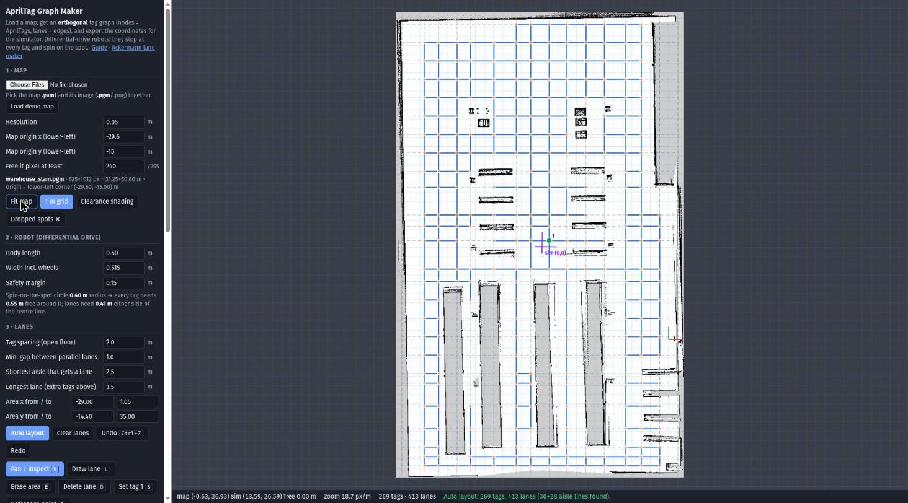
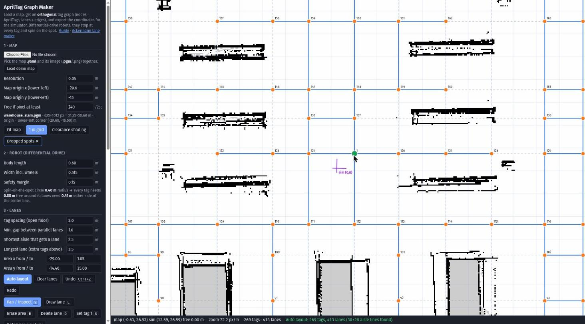
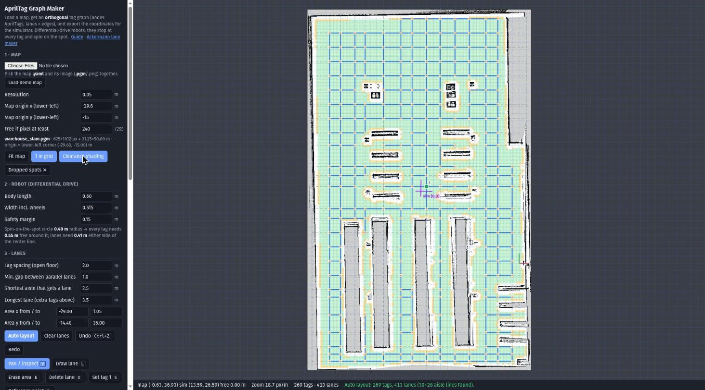
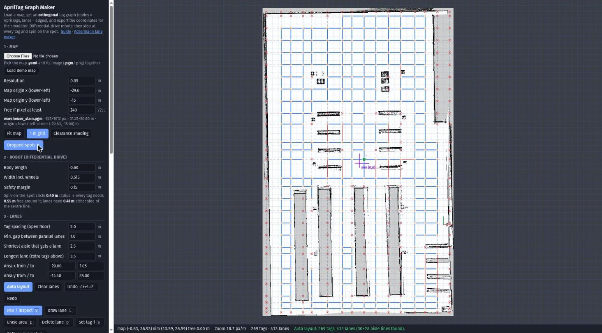
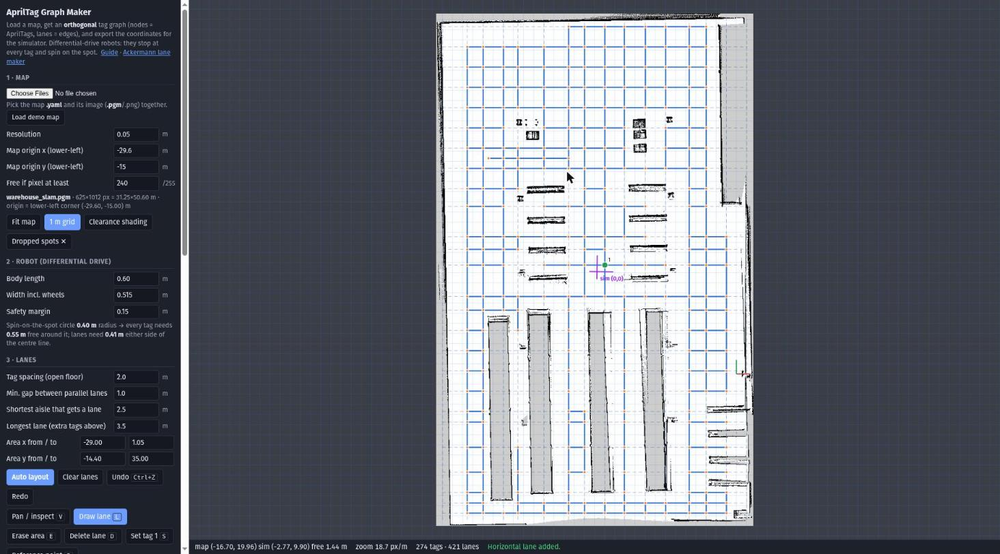
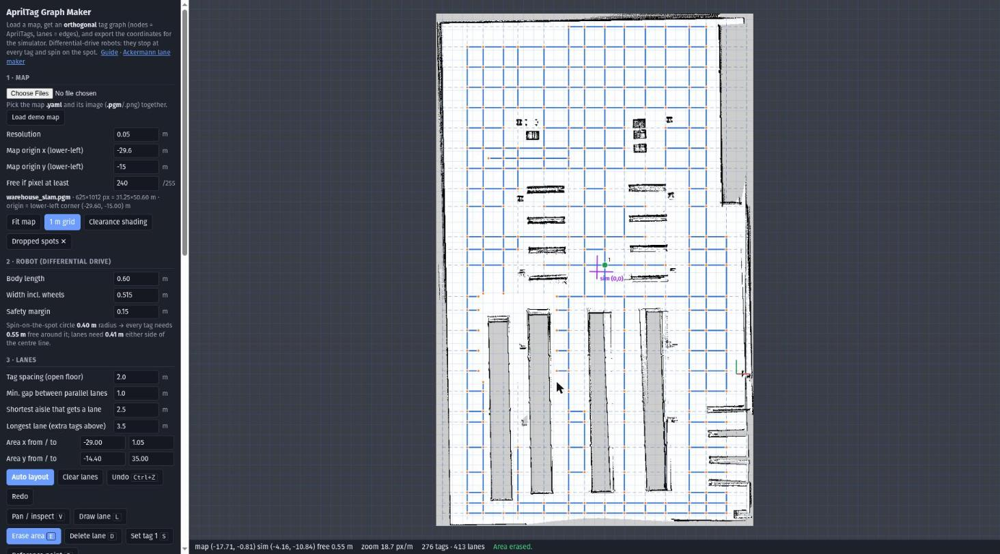
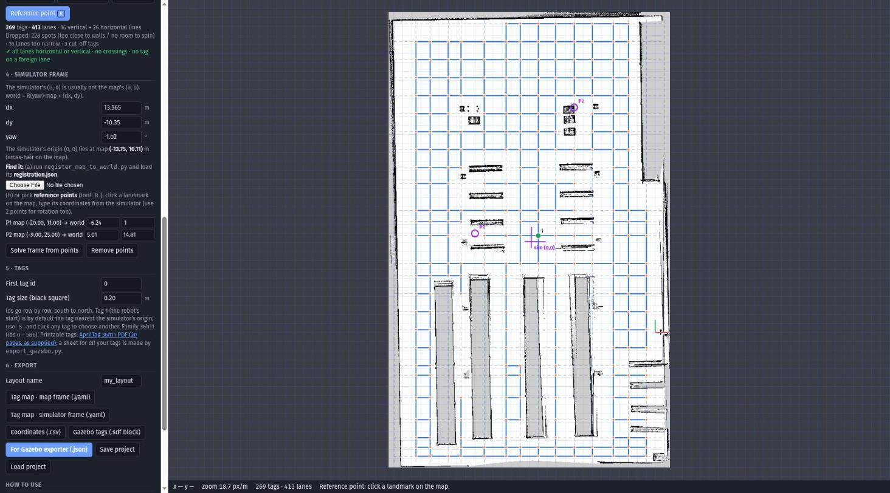
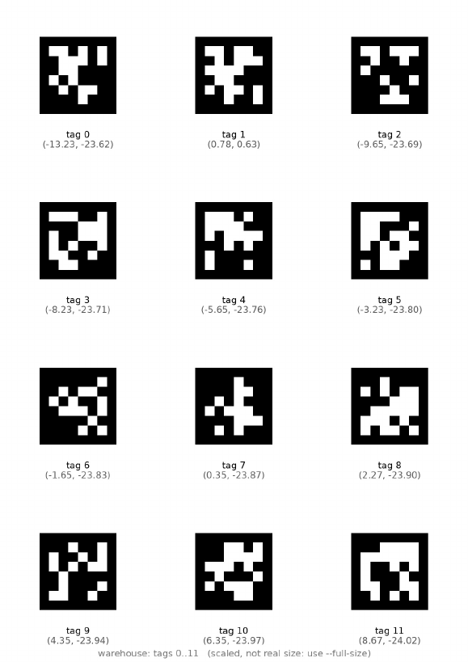

# AprilTag Graph Maker

Turn a **map** into an **AprilTag graph** for a differential-drive AGV: where to put every tag, which tags are joined by lanes, and the exact coordinates, in your map's frame **and** in the simulator's frame, ready to drop into Gazebo.



*The warehouse map with the automatic layout: 269 tags (orange dots) joined by 413 lanes (blue). The green dot is **tag 1** (the robot's start) and the purple cross is the **simulator's origin**.*

**What you get**
- an **orthogonal** graph: every lane is horizontal or vertical (never diagonal), lanes are parallel or perpendicular, they never cross in mid-lane and never overlap;
- **maximum coverage**: a lane runs along the centre of every aisle between racks, plus a regular lattice on open floor;
- tags only where a **differential-drive robot** fits: room to *spin on the spot* at every tag, room to drive every lane;
- coordinates in the **map frame** and the **simulator (Gazebo world) frame**, with the frame found automatically or by reference points;
- a ready **Gazebo world with every tag placed at those coordinates**, the tag textures, the robot's start pose, and a **printable tag sheet (PDF)**.

---

## Contents
1. [Quick start](#1-quick-start)
2. [The workflow](#2-the-workflow)
3. [A tour of the GUI](#3-a-tour-of-the-gui) (with screenshots)
4. [How it works](#4-how-it-works)
5. [Worked example: map to Gazebo](#5-worked-example-map-to-gazebo)
6. [Command-line and URL reference](#6-command-line-and-url-reference)
7. [Tests and measured results](#7-tests-and-measured-results)
8. [Files](#8-files)
9. [Limits](#9-limits)

---

## 1. Quick start
```bash
cd fms_lane_maker
python3 -m http.server 8000
```
Open **http://localhost:8000/tag_graph_maker.html** in Chrome, Brave or Firefox and press **Load demo map**, then **Auto layout**.
(Opening the `.html` file directly also works, only the demo button needs the small server.)

A link that loads the demo map, runs the auto layout and applies the simulator frame found for it:
`http://localhost:8000/tag_graph_maker.html?map=testmap/warehouse_slam.yaml&auto=1&frame=13.565,-10.35,-1.02`

Requirements: a browser; Node.js (only for the tests and the command-line version); Python 3 with `numpy`, `scipy`, OpenCV with the ArUco/AprilTag module (`python3-opencv` from apt, or `opencv-contrib-python` from pip) and `Pillow` (only for the registration tool and the Gazebo exporter).

## 2. The workflow
```
 your map (.pgm + .yaml)
    │
    │  ① AprilTag Graph Maker (browser)
    │       robot size  ->  auto layout  ->  edit by hand (draw / erase)  ->  check
    │
    │  ② frame: map -> simulator world
    │       register_map_to_world.py   (automatic: finds "the 0 of the environment")
    │       or reference points / numbers in the GUI
    ▼
 <name>.taggraph.json   (tag ids, coordinates in BOTH frames, lanes)
    │
    │  ③ export_gazebo.py
    ▼
 Gazebo world with the tags  ·  tag map .yaml  ·  robot start pose  ·  textures  ·  printable tag sheet (PDF)
```

---

## 3. A tour of the GUI

### 3.1 Map and robot
Choose the map's `.yaml` **together with** its image (`.pgm` or `.png`). The tool reads the resolution and the origin from the yaml (the ROS convention: the origin is the pose of the **lower-left** pixel).
Pixels at least as bright as *Free if pixel at least* (default 240 of 255) are free. **Walls and the grey "unknown" pixels both block**, so a robot is never planned into space nobody has looked at.

In *Robot* give the length, the width **including the wheels**, and a safety margin. For the demo robot (0.60 × 0.515 m, margin 0.15 m) the tool shows what that means:

> Spin-on-the-spot circle **0.40 m** radius → every tag needs **0.55 m** free around it; lanes need **0.41 m** either side of the centre line.

### 3.2 Auto layout
**Auto layout** finds the centre line of every aisle in the map and adds a lattice (default 2 m) on open floor. Close up, you can see how tags (orange) sit at the crossings of the lanes (blue), each labelled with its id, and that **tag 1 (green) is the tag nearest the simulator's origin (purple cross)**:



The parameters in section 3 of the sidebar: *tag spacing* on open floor, *min. gap between parallel lanes*, *shortest aisle that gets a lane*, *longest lane* (a longer lane gets extra tags) and the *area* to cover.

### 3.3 Where there is room: clearance shading and dropped spots
**Clearance shading** colours the map by what fits: **green** = tags fit, **amber** = lanes fit but a robot could not spin, uncoloured = nothing fits. Walls, racks and a margin around them stay clear.



**Dropped spots ✕** marks every lane crossing that was **rejected** because a robot could not spin there (and lanes that are too narrow, in red). They cluster along the walls and around racks and pallets, exactly where they should:



### 3.4 Editing by hand
The lane layout is a set of horizontal and vertical lines, so editing means drawing or erasing lines. Everything else (tags, lanes, ids, checks) follows automatically.

| Tool | Key | What it does |
|---|---|---|
| Pan / inspect | `V` | drag to move the view; click a tag to read its coordinates in both frames |
| Draw lane | `L` | press, drag, release. **Always snaps to horizontal or vertical** (even if you drag diagonally), to existing tags, and to existing lane positions so parallel and perpendicular stay exact |
| Erase area | `E` | drag a rectangle: lanes inside are cut away |
| Delete lane | `D` | click a lane to remove the whole line |
| Set tag 1 | `S` | click a tag: it becomes tag 1 (the robot's start) |
| Reference point | `R` | click a landmark to calibrate the simulator frame (see 3.5) |
| Undo / Redo | `Ctrl+Z` / `Ctrl+Y` | up to 200 steps |
| Zoom / pan | wheel / right-drag | |

**Draw lane**: a drag that is slightly diagonal (115 px right, 20 px down) produced a horizontal lane; the status line confirms it (274 tags, 421 lanes):



**Erase area** cuts the lanes inside the rectangle (the gap left of centre); everything stays clean:



The panel below the tool buttons re-checks the graph after every edit: *all lanes horizontal or vertical · no crossings · no tag on a foreign lane*, and warns about parallel lanes closer than the minimum gap.

### 3.5 The simulator frame ("where is the 0 of the environment?")
A map from SLAM or a floor plan has its own origin; the simulator has another. The tool keeps one transform

**`world = R(yaw) · map + (dx, dy)`**

and draws the simulator's (0, 0) as the **purple cross** on the map. Three ways to fill it (section 4 of the sidebar):

1. **Automatic**: `register_map_to_world.py` lays your map over a ground-truth map of the simulator and writes `registration.json`; load it with *Choose File* (see [4.7](#47-registration-finding-the-origin-automatically)).
2. **Reference points**: press `R`, click a landmark on the map (a pillar, a rack corner), then type its coordinates as the simulator shows them. One point gives the shift, **two points also give the rotation**, and the tool warns if the scale between the two points is off.
3. **Numbers**: type dx, dy, yaw if you know them.



*Sidebar sections 4 to 6. P1 and P2 are two reference points; under them the frame found for the demo map (dx 13.565 m, dy −10.35 m, yaw −1.02°), and the statement "the simulator's origin lies at map (−13.75, 10.11)".*

### 3.6 Tags and export
Ids go **row by row, south to north, west to east**, from *First tag id*. **Tag 1** (the robot's start) is by default the tag nearest the simulator's origin; use `S` to choose another. *Tag size* is the black square (0.20 m); with the white quiet zone the printed tag is 0.25 m.

Section 6 writes (all names start with the *Layout name*):

| Button | File | Use |
|---|---|---|
| Tag map · map frame | `<name>_tag_map_map_frame.yaml` | tag id → x, y in **your map's** frame |
| Tag map · simulator frame | `<name>_tag_map_world.yaml` | the same in the **simulator** frame: the table a navigation stack loads |
| Coordinates | `<name>_coordinates.csv` | id, x and y in both frames, tag yaw: to place tags by hand or survey a real floor |
| Gazebo tags | `<name>_tags_block.sdf` | `<model>` blocks to paste into any world before `</world>` |
| **For Gazebo exporter** | `<name>.taggraph.json` | everything `export_gazebo.py` needs |
| Save / load project | `<name>_project.json` | continue editing later (the map image is loaded separately) |

The printable sheet that `export_gazebo.py` writes (page 1 of 23 for the warehouse; each tag labelled with its id and world coordinates):



The AprilTag 36h11 PDF that came with the project is kept in [`assets/AprilTag_0-20_family36h11.pdf`](assets/AprilTag_0-20_family36h11.pdf) and linked from the GUI.

---

## 4. How it works

### 4.1 The clearance field
From the map image the tool builds a **clearance field**: for every pixel, the distance in metres to the nearest blocked pixel (wall, rack, or grey unknown). It uses the exact Euclidean distance transform (Felzenszwalb & Huttenlocher, two linear passes; the test compares it with brute force). Every question the tool asks afterwards, "is there room here?", is a lookup in this field.

### 4.2 Differential-drive constraints
A differential-drive robot cannot slide sideways and has no steering radius: it **stops at a tag, turns on the spot, and drives a straight lane**. That gives two simple rules, from the robot size *L × W* and margin *m*:

```
spin circle radius   r = sqrt((L/2)² + (W/2)²)          0.395 m for 0.60 x 0.515
tag is valid     <=> clearance >= r + m                 0.55 m   (room for the spot turn)
lane is valid    <=> clearance >= W/2 + m  along it     0.41 m   (room for the body, incl. the wheels)
```
Because all turns happen on the spot at a tag, lanes need no turning radius, and they meet **at right angles** only.

### 4.3 Lane lines, tags and lanes
The graph is stored as **lane lines**: vertical lines `x = c` over a range of `y`, horizontal lines `y = c` over a range of `x` (in the map frame). The tags and lanes are **derived**:

1. collinear overlapping lines are **merged** (so no overlapping lanes);
2. a **tag** is created at both ends of a line, at **every crossing** of two lines, and every *longest lane* metres along a line;
3. a **lane** joins two **consecutive** tags of a line;
4. a tag is kept only if its clearance is ≥ `r + m`; a lane only if both its tags are kept and the clearance along it is ≥ `W/2 + m` (sampled every 5 cm);
5. only the largest connected part is kept.

This is why the result is always clean: a diagonal lane cannot exist (lines are axis-aligned); parallel lanes are just parallel lines; two lanes can only meet **in a tag** because every crossing is a tag, so there are no cross-cross edges; and a lane never skips over a crossing. After every edit the tool also *verifies* it: it counts diagonal lanes, tests all lane pairs for crossings, and tests that no tag lies on another lane's line.

### 4.4 The automatic layout
1. **Aisle centre-lines.** For every 2nd row of the map the free runs between obstacles are found; a run 0.8 – 5 m wide is a corridor and "votes" for its centre. Where many rows vote for the same centre (a corridor at least *shortest aisle* long), that centre becomes a vertical lane line. The same is done on the columns for horizontal lines. So **every aisle between racks gets its own lane**.
2. **Lattice.** A regular lattice (default 2 m) covers the open floor.
3. **Merging.** Lattice lines closer than the *min. gap between parallel lanes* to an aisle line are dropped, so parallel lanes never crowd each other.

On the warehouse map this found 30 + 28 aisle lines and, after the clearance checks, **269 tags and 413 lanes**.

### 4.5 Ids and tag 1
Ids run row by row (south → north, west → east) from the first id. The tag nearest the simulator's origin (or the one you pick with `S`) swaps ids with tag 1, so the robot always starts on tag 1. Family 36h11 has ids 0 – 586, so a layout can have at most 587 tags; the tool says so if it is exceeded.

### 4.6 The coordinate frames
* **Map frame.** The occupancy map's frame. Its origin is the **lower-left pixel** (`origin` in the yaml), the first row of a `.pgm` is the **top** of the map, x to the right, y up, angles counter-clockwise, metres.
* **World (simulator) frame.** What the simulator calls (0, 0).
* **Transform.** `world = R(yaw) · map + (dx, dy)`. The tag yaw in the world frame is the frame's yaw (the tags rotate with the map), so a tag drawn "upright" on the map is placed upright in the world.
* Lanes are orthogonal **in the map frame**. If the registration finds a small rotation (a SLAM map is often a degree or so off), the lanes are rotated by it in the world: parallel to the real aisles, which is what you want.

### 4.7 Registration: finding the origin automatically
`register_map_to_world.py` answers "where is the simulator's origin on my map?" by overlaying two occupancy maps of the same place:

* **your map** (map frame), and
* a **ground-truth map of the simulator** (world frame by construction). `agv_tag_nav/scripts/gz_floorplan.py` (from the `ros2_agv` project) makes it: it moves the robot's lidar over a grid of known positions in the running simulator and rasterises each scan at its exact pose, so there is no SLAM drift.

The search: occupied pixels of both maps → for **each yaw** (every 2°, all 360°) an **FFT cross-correlation** finds the best shift → the best candidates are refined with a **chamfer-distance** search (down to 1 cm and 0.02°). It reports the fit quality, and warns when fewer than half of the points agree.

On the real warehouse (your SLAM map against the simulator's map) it found **`world = R(−1.02°) · map + (13.565, −10.35)`** with a median error of 5 cm, 73% of points within 15 cm and 88% within 30 cm. A pure translation (13.55, −10.00, no rotation), which I had estimated by hand from shelf edges, fits clearly worse (median 10 cm, 56% within 15 cm, 76% within 30 cm): the SLAM map is rotated by about a degree against the world, which only a rotation-aware fit can see. On synthetic tests (known shift and rotation, only 50 – 60% of the points visible, 3 cm noise) it recovers the shift to within 4 cm and the rotation to within 0.02°, including a −123° rotation.

### 4.8 Putting the tags into Gazebo
`export_gazebo.py` reads the `.taggraph.json` and writes, for the world you give it:

* **one flat model per tag** (`<model name="tag_<id>">`) at the tag's world (x, y), 1.1 cm above the floor (`--tag-z`), rotated by the frame's yaw. The visual is a 0.25 × 0.25 m plane with the tag's texture (0.20 m black square + white quiet zone);
* **textures**: `tag36_11_NNNNN.png`, rendered from OpenCV's 36h11 dictionary (8 × 8 cells including the black border + a 1-cell white border), in the same orientation convention as the project's earlier tag models;
* `tag_map_warehouse_<name>.yaml`: the table *tag id → (x, y, yaw)* plus the lanes, in the format the navigation stack loads;
* `warehouse_<name>.spawn.yaml`: the robot's **start pose**: on tag 1, facing along a lane;
* `tags_sheet.pdf`: tags with ids and coordinates (contact sheet; `--full-size` = real size, A3, one per page).

`--remove-model <name>` removes an unwanted model from the world (for the warehouse: the unused `tugbot` robot), and `--ros2-agv <workspace>` installs everything into a `ros2_agv` workspace so the layout starts with `ros2 launch agv_tag_nav agv01_navigation.launch.py layout:=<name>`.

**How the robot uses it.** A 36h11 tag only carries an **id**, not a position. The table above is the key: when a camera sees tag *k*, the navigation stack looks up *k*'s world coordinates and, from the measured pose of the tag in the camera, works out where the robot is. Because the simulated tags and the table are generated from the same `.taggraph.json`, they agree to the millimetre.

---

## 5. Worked example: map to Gazebo
```bash
cd fms_lane_maker

# 1. graph from the map, in the simulator frame found for it (the GUI does the same with Auto layout + the frame fields)
node auto_layout_cli.js --map testmap/warehouse_slam.yaml --frame 13.565 -10.35 -1.02 --name warehouse --out warehouse.taggraph.json
#   269 tags, 413 lanes (30+28 aisle lines), diagonal 0, crossings 0, tags on foreign lanes 0; dropped spots 228, narrow lanes 16
#   tag 1 at map (-12.98, 10.75) = simulator (0.78, 0.63);  frame: dx 13.565 dy -10.350 yaw -1.02 deg

# 2. Gazebo world with the tags (and the Tugbot removed), tag map, start pose, textures, printable sheet
python3 export_gazebo.py warehouse.taggraph.json --world-in tugbot_warehouse.sdf --remove-model tugbot --out-dir out
#   269 tags, 413 lanes -> out   (worlds/warehouse_warehouse.sdf, config/tag_map_warehouse_warehouse.yaml, start: tag 1 at (0.783, 0.629) yaw 1.553, sheet: 23 pages)
```
What the files look like:

`config/tag_map_warehouse_warehouse.yaml`
```yaml
family: tag36h11
tag_size: 0.2
frame: map
nodes:
  0: {x: -13.226, y: -23.625, yaw: -0.018}
  1: {x: 0.783, y: 0.629, yaw: -0.018}
  2: {x: -9.651, y: -23.689, yaw: -0.018}
edges:
- {from: 0, to: 14, is_bidirectional: true}
```
`worlds/warehouse_warehouse.spawn.yaml`: `x: 0.783  y: 0.629  yaw: 1.5527  tag: 1`

`<name>_coordinates.csv` (from the GUI)
```
tag_id,x_map_m,y_map_m,x_world_m,y_world_m,tag_yaw_world_rad
0,-26.55,-13.75,-13.226,-23.625,-0.018
1,-12.975,10.75,0.783,0.629,-0.018
2,-22.975,-13.75,-9.651,-23.689,-0.018
```
(The tag at map (−12.975, 10.75) is at simulator (0.783, 0.629): the same physical spot, written in the two frames.)

**Verified in the simulator.** A world generated this way (from the SLAM map through the automatically registered frame) was loaded in Gazebo with the AGV navigation stack. The robot spawned on tag 1, localised from it at once, and drove three goals, about 70 m in total, including a tag inside a rack aisle: **all three arrived, stop errors 1.8 – 1.9 cm, position estimate within 7.3 cm of Gazebo's ground truth** the whole way.

---

## 6. Command-line and URL reference

**`auto_layout_cli.js`** (same logic as the GUI, no browser)

| Option | Default | |
|---|---|---|
| `--map <yaml>` | | the occupancy map |
| `--registration <json>` / `--frame dx dy yawDeg` | none | simulator frame |
| `--robot L W margin` | 0.60 0.515 0.15 | robot size in metres |
| `--spacing` / `--min-sep` / `--min-aisle` / `--max-edge` | 2.0 / 1.0 / 2.5 / 3.5 | layout parameters in metres |
| `--bounds x0 x1 y0 y1` | map inset 0.6 m | area to cover (map frame) |
| `--free-gray` | 240 | brightness (of 255) from which a pixel is free |
| `--start-near-world X Y` | the simulator's origin | this tag becomes tag 1 |
| `--name`, `--out`, `--tag-size` | layout, `<name>.taggraph.json`, 0.20 | |

**`register_map_to_world.py --map <yaml> --world-map <yaml> --out registration.json [--yaw-range MIN MAX] [--yaw-step 2]`**

**`export_gazebo.py <graph.json> --world-in <world.sdf> [--out-dir out] [--ros2-agv <ws>] [--remove-model NAME]... [--tag-z 0.011] [--full-size] [--no-sheet]`**

**URL options** of `tag_graph_maker.html` (handy for demos and for the screenshots in this README): `map=<yaml path>` (loads a map from the served folder), `auto=1`, `frame=dx,dy,yawDeg`, `shade=1`, `drop=1`, `zoom=cx,cy,pxPerMetre`, `demo=draw|erase|refs`.

## 7. Tests and measured results
```bash
node tests/test_core.js                 # 15 checks
python3 tests/test_register.py          # 3 synthetic registrations
bash tests/run_gui_selftest.sh          # 8 checks in a real (headless) browser
```
* **Core (15):** distance transform equals brute force; lane lines → graph with 0 diagonal lanes, 0 crossings, 0 tags on a foreign lane; no tag within spin distance of an obstacle; unique ids; overlapping collinear lines merge; frame conversion round trips (also rotated); a 2-point calibration recovers dx, dy, yaw and scale; the yaml and SDF exports have the expected format; the warehouse layout is clean.
* **In the browser (8):** auto layout is clean; a diagonal drag produces no diagonal lane; a drawn lane keeps the graph clean; undo restores the original layout exactly; erase keeps it clean and undo restores it; reference points solve the frame; the exports hold every tag and lane.
* **By hand in Chrome:** drawing, erasing and undoing with the mouse behaved as above (269 → 274 tags when a lane is drawn; undo twice returns exactly 269 tags and 413 lanes); no console errors.
* **Registration:** 3 synthetic cases recovered within 4 cm and 0.02°; on the real maps see 4.7.
* **Simulation:** 3 of 3 goals reached, stop error ≤ 1.9 cm, estimate within 7.3 cm of ground truth (section 5).

## 8. Files
| File | What |
|---|---|
| `tag_graph_maker.html` | the GUI |
| `tag_graph_core.js` | the logic: clearance field, auto lines, lines → tags and lanes, checks, frames, exports (used by the GUI, the CLI and the tests) |
| `auto_layout_cli.js` | the same without a browser |
| `register_map_to_world.py` | finds the simulator's origin on your map |
| `export_gazebo.py` | Gazebo world with the tags, tag map, start pose, textures, printable PDF |
| `lane_math.js` | map file parsers (shared with the Ackermann lane maker) |
| `lane_maker.html` | the earlier Ackermann (steered-vehicle) lane maker, unchanged except for a link to this tool |
| `testmap/warehouse_slam.*` | demo map: a SLAM map of the warehouse (its frame is **not** the simulator's) |
| `assets/AprilTag_0-20_family36h11.pdf` | the supplied AprilTag 36h11 PDF |
| `docs/images/` | the screenshots used here |
| `tests/` | the tests above |

## 9. Limits
* Lanes are orthogonal in the **map** frame; a registration rotation tilts them equally in the world.
* The layout only knows the map: obstacles that are not in it (or lie below the lidar plane that made it) are not avoided. Check the layout against the world once.
* Registration needs both maps to show the same structures; it reports its fit and warns below 50% inliers. The ground-truth map comes from `gz_floorplan.py`, which needs the simulator running.
* Two-way lanes only (no one-way lanes yet), one level (no lifts).
* Tested with a differential-drive robot of 0.60 × 0.515 m in Gazebo only; nothing here has been tried on a real floor.
